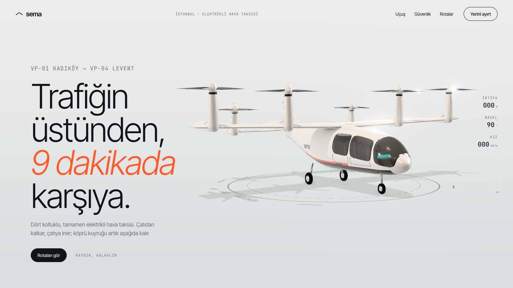

# sema · 3D Uçan Araba (Hava Taksisi) Sitesi



Hayali bir İstanbul hava taksisi şirketi (sema) için hazırlanmış bir 3D web sitesi. Altı pervaneli, dikey kalkan uçan araba Blender'da Python ile, tamamen kodla modellendi. Site kaydırdıkça canlanıyor: araç pistten kalkıyor, tekerlerini topluyor, naseller öne yatıp uçak gibi uçuyor, bir motor durunca diğer beşi devam ediyor, sonunda akşam oluyor.

📺 Bu proje [Satır Satır Kod](https://www.youtube.com/@satirsatirkod) YouTube kanalında sıfırdan, satır satır kodlandı.

## Neler var?

- Blender'ı Python ile yönetip aracı kodla modellemek: süperelips kesitli gövde, NACA profilli kanat, torna ile naseller, kabin, koltuklar, iniş takımları
- Draco ile sıkıştırılmış GLB (bütün araç yarım megabayttan küçük)
- Gerçekçi malzemeler: vernikli inci beyazı boya, karbon pervaneler, füme cam, kumaş koltuklar
- Gövdede pencere boşluklarını açan küçük bir shader, DecalGeometry ile gövdeye yapışan yazılar
- Dönen pervanelerin bıraktığı yarı saydam iz, yanıp sönen seyir ışıkları
- GTAO, bloom ve SMAA ile son işlem
- Kaydırma hikâyesi: kalkış, teker toplama, naselleri yatırma, motor arızası, rotalar ve akşam
- Masaüstünde ve telefonda 60 kare

## Kullanılanlar

Blender · Python · Three.js · GSAP · Lenis · Vite

## Çalıştırma

```bash
npm install
npm run dev
```

Yayın için `npm run build`; çıktı `dist/` klasörüne yazılır.

3D aracı Blender'da yeniden üretmek için (Blender 4+):

```bash
blender -b -P blender/hava_taksi.py -- "$PWD"
```

## Klasörler

- `src/`: sitenin kodu (sahne, araç, kodla çizilen dokular)
- `blender/`: aracı modelleyen Python betiği
- `public/`: hazır model (GLB), HDRI ve Draco çözücü

## Kaynaklar

Stüdyo ışığı (HDRI): [Studio Small 09](https://polyhaven.com/a/studio_small_09), Poly Haven (CC0). Diğer bütün dokular kodla çiziliyor.

sema hayali bir şirkettir; bu proje bir tasarım çalışmasıdır.

## Lisans

Kod [MIT](LICENSE) lisanslıdır. Poly Haven varlıkları CC0, Draco çözücü (`public/draco/`) Apache 2.0 lisanslıdır.
